# llm-balancer

> **Hinweis:** Dieses Projekt ist KI-generiert. Code, Tests und Dokumentation wurden mit Claude (Anthropic) erstellt
> und vom Betreiber in der eigenen Umgebung eingesetzt und getestet. Es gibt keine Gewähr – vor dem Einsatz bitte
> selbst prüfen, insbesondere bei öffentlich erreichbaren Installationen.

Kleiner, abhängigkeitsfreier Reverse-Proxy für lokale LLM-Server (llama.cpp, Ollama, vLLM, LM Studio …),
die nur **wenige oder nur eine Anfrage gleichzeitig** sinnvoll verarbeiten können.

Statt zufällig zu verteilen zählt der Balancer die **offenen Verbindungen pro Server**:

* Ist ein passender Server frei → Anfrage geht sofort dorthin.
* Ist er belegt → nächster freier Server, der das angefragte Modell hat.
* Sind alle belegt → Anfrage wartet in einer **Warteschlange**, bis ein Slot frei wird.

Request und Response werden **1:1 durchgereicht** (Body, Header, SSE-Streaming ohne Pufferung). Den Modellnamen liest
der Balancer, um den richtigen Server zu finden; ändern tut er ihn nur, wenn du es einstellst (Router, Fallback,
erzwungenes Modell).

```
Hermes-Agent ─► LiteLLM ─► llm-balancer :8080 ─┬─► LLM-Server A (1 Slot)
Open WebUI ───────────────►                    ├─► LLM-Server B (1 Slot)
                                               └─► Ollama-Server C (1 Slot)
```

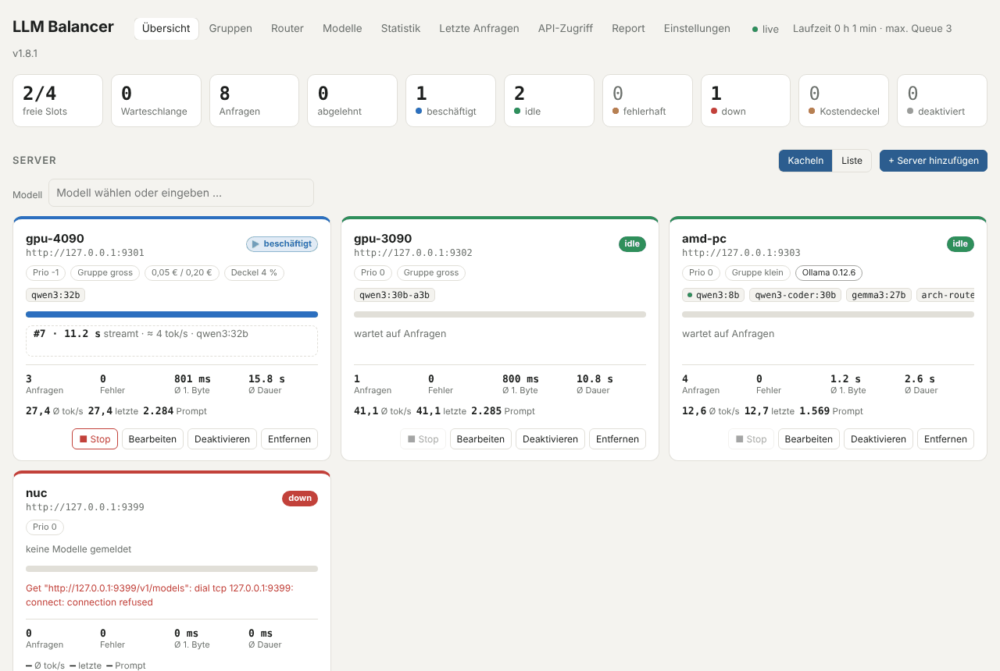

## Funktionsumfang

**Verteilung**
* Slot-Zählung pro Server (`max_concurrent`, Standard 1) – der Slot wird erst frei, wenn der Stream beendet ist oder der Client abbricht
* Warteschlange mit optionalem Limit und Timeout; jede Gruppe wartet fair für sich
* Priorität pro Server (kleiner = bevorzugt, z. B. die schnellere GPU), sonst reihum
* **Servergruppen** mit Routing nach Modell: Anfragen gehen nur an Server, die das Modell haben; Modellfilter und Ersatzmodell pro Server
* **Fallback-Gruppe**: nach einer Wartezeit oder sofort, wenn die Gruppe ausfällt bzw. deaktiviert ist – optional mit anderem Modell
* **Modell-Router**: virtuelle Modelle wie `auto` wählen per Regeln (Größe, Bilder, Tools, Text-Muster, API-Token, Last, Uhrzeit …) oder per Klassifizierer (Heuristik wie LiteLLM, kleines LLM, **Arch-Router**) das passende Modell – optional mit Session-Bindung
* **Fehler bleiben intern**: liefert ein Server einen Fehler (auch 404, abgebrochener Stream, leere Antwort), versucht der Balancer den nächsten passenden Server und dann den Fallback, bevor der Client etwas merkt

**Server**
* OpenAI-kompatible Server und **Ollama** (automatisch erkannt), http und https (auch selbstsigniert), Bearer-Token pro Server
* Health-Checks und Modellerkennung über `/v1/models` bzw. `/api/tags`; Modell-Fähigkeiten (Bilder, Tools, Denken, Kontext) – bei Ollama automatisch
* Native **Ollama-API** am Balancer (`/api/chat`, `/api/generate`, `/api/embed`, `/api/tags` …) – z. B. für Open WebUI
* **Modellverwaltung für Ollama**: herunterladen (mit Fortschritt, auf mehrere Server), kopieren, löschen, entladen
* Server, Gruppen und Router im laufenden Betrieb ändern; STOP-Knopf für laufende Anfragen; Prüfung von `<think>`-/`<tool_call>`-Tags im Text

**Zugriff und Kosten**
* API-Tokens für die LLM-API mit **erlaubten Modellen**, Preisen (eingehend), Kostendeckel und Sperre
* Preise und Kostendeckel pro Server (ausgehend) – mit Saldo in der Statistik
* **Benutzerverwaltung** für die Web-UI mit Rollen Administrator / Operator / Betrachter
* E-Mail-Benachrichtigung bei Ausfällen, Fehlern und erreichten Kostendeckeln
* Konfiguration exportieren/importieren (mit oder ohne Geheimnisse)

**Auswertung**
* Live-Übersicht mit Zustand jedes Servers, laufenden Anfragen, tok/s und Warteschlange
* Statistik pro Tag, Server, Modell und API-Token (7 Tage bis 1 Jahr, Diagramm, CSV), **Tagesansicht der Auslastung** pro Stunde, Statistik der Warteschlange
* Letzte 300 Anfragen mit Session-Erkennung, Retry-Weg, Router-Entscheidung, Tokens und Kosten
* Prometheus-Metriken unter `/balancer/metrics`, JSON-API für alles, was die UI kann
* Eine statische Go-Binary ohne Abhängigkeiten, Docker-Image `FROM scratch`; alles Veränderliche liegt in `/data`

## Start

### docker compose / Portainer-Stack

```yaml
services:
  llm-balancer:
    image: ghcr.io/wakkomon/llm-balancer:latest   # oder: build: .
    restart: unless-stopped
    ports: ["8080:8080"]
    environment:
      BACKENDS: "gpu=http://192.168.1.50:8080,amd=http://192.168.1.60:8080@1"
    volumes:
      - llm-balancer-data:/data
volumes:
  llm-balancer-data:
```

Vollständige Vorlage: `portainer-stack.yml`.

Das Image wird von der GitHub-Action bei jedem Push auf `main` nach `ghcr.io/wakkomon/llm-balancer:latest` gebaut,
zusätzlich als `ghcr.io/wakkomon/llm-balancer:<version>` laut Datei `VERSION` (z. B. `:1.0.1`, dazu Git-Tag `v1.0.1`) – damit lässt sich eine Version festnageln
(beim ersten Mal das Package unter GitHub → Packages auf „public“ stellen oder `docker login ghcr.io`).

### Ohne Docker

```bash
go build -o llm-balancer .
BACKENDS="http://host-a:8080,http://host-b:8080" ./llm-balancer
```

## Bedienung

Die Web-UI liegt unter `http://<host>:8080/balancer/` und aktualisiert sich jede Sekunde. Alle Tabellen lassen sich
per Klick auf die Spaltenüberschrift sortieren. Die Screenshots zeigen eine Beispiel-Installation mit zwei GPU-Servern
(Gruppe „gross“), einem Ollama-Server (Gruppe „klein“) und einem ausgefallenen Server.

### Erste Schritte

1. Stack starten (siehe oben) und die Web-UI öffnen.
2. **Einstellungen → Benutzer**: ersten Administrator anlegen – ab dann braucht die Web-UI eine Anmeldung.
3. **Übersicht → + Server hinzufügen**: URL des LLM-Servers ohne `/v1` (z. B. `http://192.168.1.50:8080`), Anzahl
   paralleler Anfragen, ggf. Bearer-Token. Der Typ (OpenAI-kompatibel / Ollama) wird automatisch erkannt.
4. **API-Zugriff → + Token erstellen**: Token für LiteLLM, Hermes oder Open WebUI erzeugen und dort als API-Key eintragen.
5. Clients auf `http://<host>:8080/v1` (OpenAI) bzw. `http://<host>:8080` (Ollama) zeigen lassen.

Optional danach: **Gruppen** anlegen, wenn Server unterschiedliche Modelle bedienen, und einen **Router**, wenn der
Balancer das Modell selbst wählen soll.

### Übersicht

Oben die Kacheln: freie Slots, Länge der Warteschlange, Anfragen seit Start, abgelehnte Anfragen und wie viele Server
gerade beschäftigt, frei, fehlerhaft, nicht erreichbar, am Kostendeckel oder deaktiviert sind.

Darunter jeder Server als Karte: Zustand (ein pulsierender ▶ zeigt „beschäftigt“), Priorität, Gruppe, Preise,
gemeldete Modelle (grüner Punkt = bei Ollama im Speicher geladen), belegte Slots, die laufende Anfrage mit Dauer und
geschätzten tok/s oder der letzte Fehler, dazu Zähler und Durchschnittswerte. Knöpfe: **Stop** bricht die laufende
Anfrage ab, **Bearbeiten**, **Deaktivieren** (laufende Anfragen laufen zu Ende) und **Entfernen**.

Im Feld **Modell** einen Modellnamen eintippen: die Übersicht zeigt, welche Gruppe und welche Server es bekommen würden.

Mit **Liste** wird jeder Server zu einer Zeile, nach Gruppen sortiert und auf-/zuklappbar; darunter die Warteschlange
mit API-Token und Wartezeit jeder Anfrage:

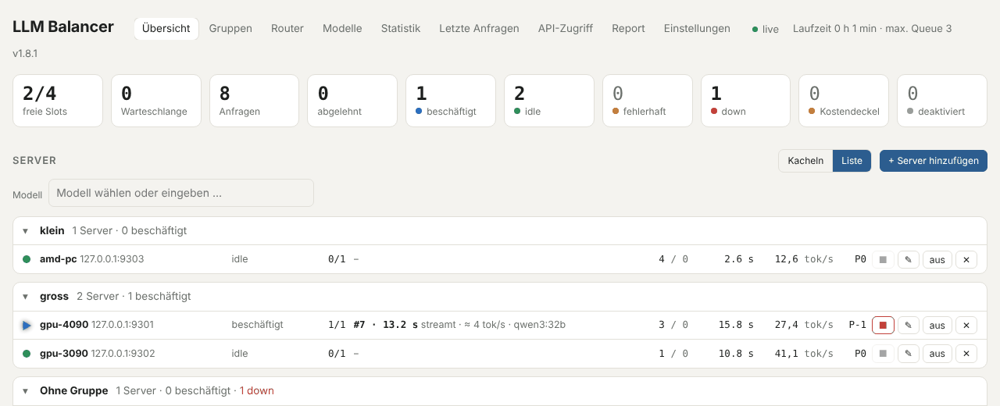

Der Dialog **Bearbeiten** eines Servers enthält Typ, Slots, Priorität, Gruppe, Modellfilter, die Modell-Fähigkeiten für
den Router (bei Ollama automatisch erkannt), ein Ersatzmodell, Preise, Kostendeckel und das Bearer-Token:

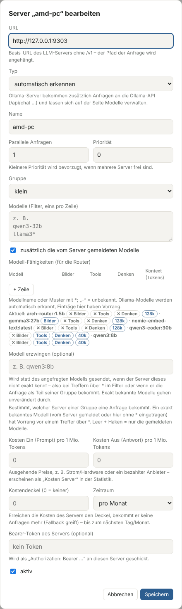

### Gruppen

Eine Gruppe fasst Server zusammen, die dieselben Modelle bedienen. Anfragen werden über den Modellnamen einer Gruppe
zugeordnet; innerhalb der Gruppe bekommen nur die Server die Anfrage, die das Modell haben. Pro Gruppe einstellbar:
zusätzliche Modellnamen/Muster, ein erzwungener Modellname und eine **Fallback-Gruppe** mit Wartezeit und Ersatzmodell.
**Deaktivieren** nimmt alle Server der Gruppe aus der Verteilung – Anfragen gehen sofort an den Fallback.

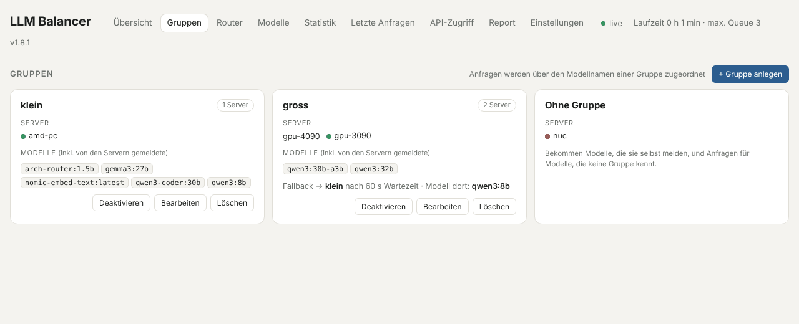

### Router

Ein Router ist ein virtuelles Modell (hier `auto`), das Clients anfragen. Er prüft seine Regeln von oben nach unten;
passt keine, entscheidet der Klassifizierer – hier Arch-Router, der die Anfrage einer beschriebenen Route zuordnet.
Pro Regel und Route steht die Zahl der Treffer. Unten lässt sich eine Anfrage einfügen und **testen**: angezeigt werden
das gewählte Modell, die erkannten Merkmale und warum andere Regeln nicht gepasst haben.

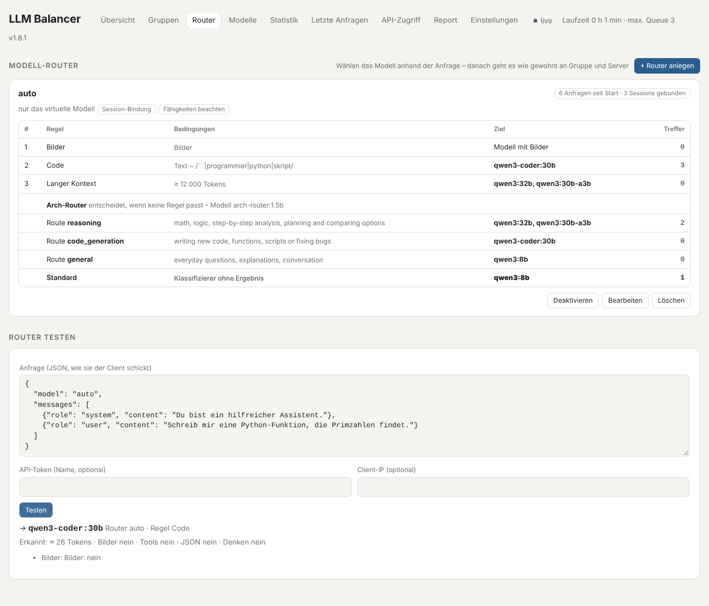

Im Dialog stehen Standardmodell, übernommene echte Modellnamen, Session-Bindung, die Regeln mit allen Bedingungen und
der Klassifizierer. Mehrere Modelle mit Komma gelten als gleichwertig – die Anfrage nimmt den ersten freien Server
mit einem davon. Details im Abschnitt [Modell-Router](#modell-router).

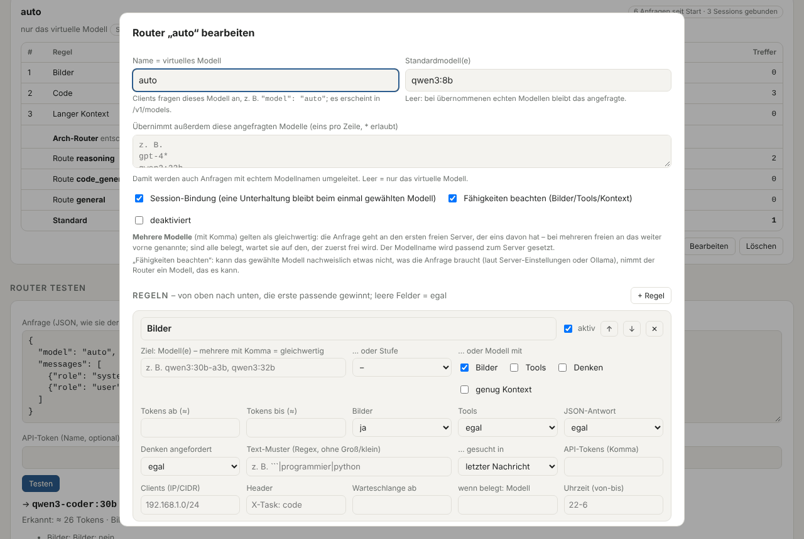

### Modelle (Ollama)

Alle Modelle aller Ollama-Server mit Größe, Parametern, Quantisierung, Familie, Fähigkeiten und Speicherbelegung.
Oben ein Modell herunterladen (Name wie auf ollama.com oder `hf.co/…`, auf einen oder mehrere Server) – der Fortschritt
erscheint darunter und läuft weiter, auch wenn die Seite geschlossen wird. Pro Modell: **Entladen** aus dem Speicher,
**Kopieren …** auf weitere Server, **Löschen**.

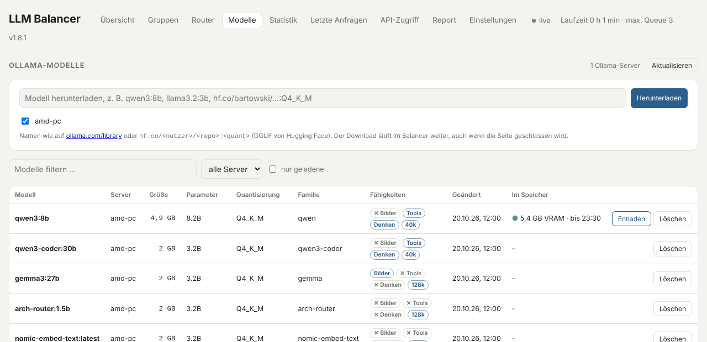

### Statistik

Zeitraum 7 Tage bis 1 Jahr, aufgeteilt nach Server oder Modell; das Diagramm zeigt Anfragen, Rechenzeit, Ø Dauer oder
Tokens pro Tag. Die Tabelle enthält Fehler, Abbrüche, Zeiten, Tokens, tok/s, Tag-Fehler, Datenmenge sowie Einnahmen
(Preise der API-Tokens), Kosten (Preise der Server) und Saldo. Darunter die Warteschlange pro Tag. **CSV-Export** und
**Statistik löschen** oben rechts. Server, die es nicht mehr gibt, lassen sich per **zusammenführen …** auf einen
vorhandenen übertragen.

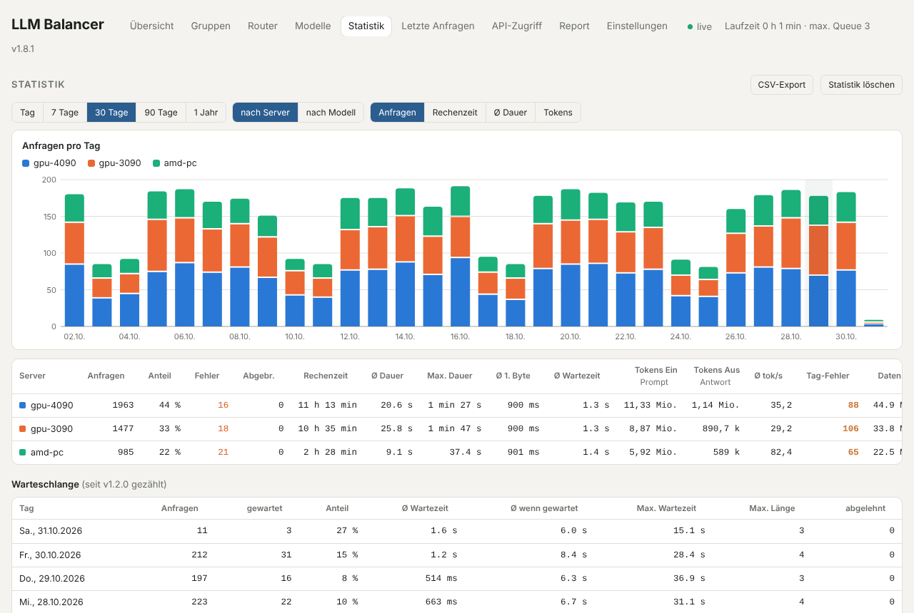

Mit **Tag** erscheint die Tagesansicht: Auslastung pro Stunde (Balken heute, Linie Ø der letzten 7 Tage), umschaltbar
auf Anfragen und Warteschlange, für alle oder einen Server – dazu Auslastung jetzt und im Vergleich zu den Vortagen.

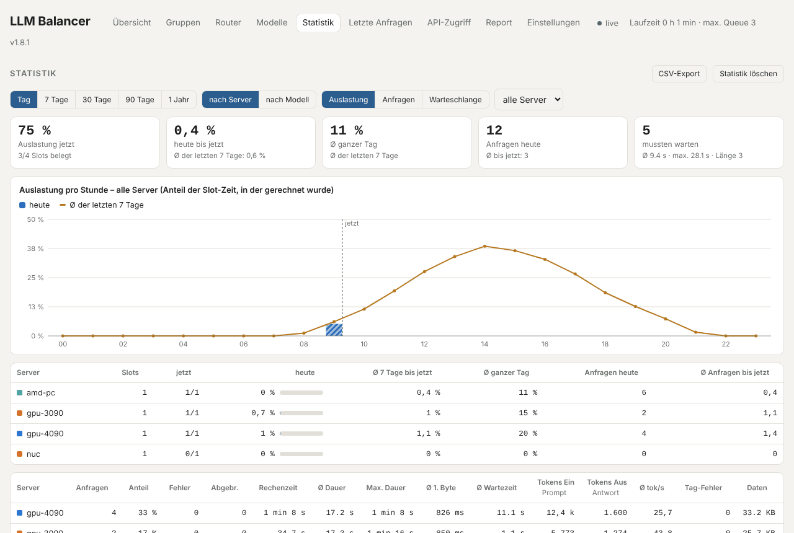

### Letzte Anfragen

Die letzten 300 Anfragen mit Zeit, Session, Modell (`auto → qwen3-coder:30b` = vom Router gewählt, ⑂ im Tooltip die
Regel), Gruppe, API-Token, Server (↻ = auf einem anderen Server wiederholt, Weg im Tooltip), Status, Wartezeit, Zeit bis
zum ersten Byte, Dauer, Tokens, tok/s, Einnahme, Kosten und Tag-Prüfung. Ein Klick auf eine **Session** zeigt nur die
Anfragen dieser Unterhaltung bzw. dieses Agenten-Laufs.

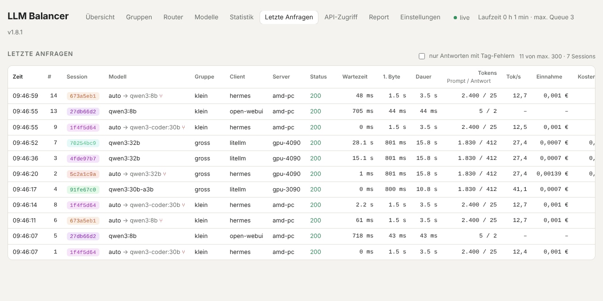

### API-Zugriff

Die Tokens für die LLM-API. Pro Token: erlaubte Modelle (unter dem Namen), Status, Quelle, zuletzt benutzt, Anfragen,
Preise, Tokens, Einnahmen im gewählten Zeitraum und Kostendeckel mit Füllstand. **Bearbeiten** ändert Name, erlaubte
Modelle, Preise und Deckel oder erzeugt einen neuen Token-Wert; **Sperren** lehnt alle Anfragen mit dem Token ab.

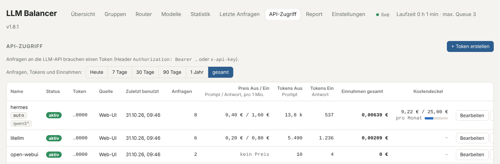

### Report

Das Ereignisprotokoll (Server nicht erreichbar / wieder da / liefert Fehler, Kostendeckel erreicht / frei), filterbar
nach Text und Art, mit dem Ergebnis des Mail-Versands. Darunter die SMTP-Einstellungen, welche Ereignisse eine Mail
auslösen und nach welcher Verzögerung – kurze Aussetzer lösen so keine Mail aus. **Testmail senden** prüft die
Einstellungen.

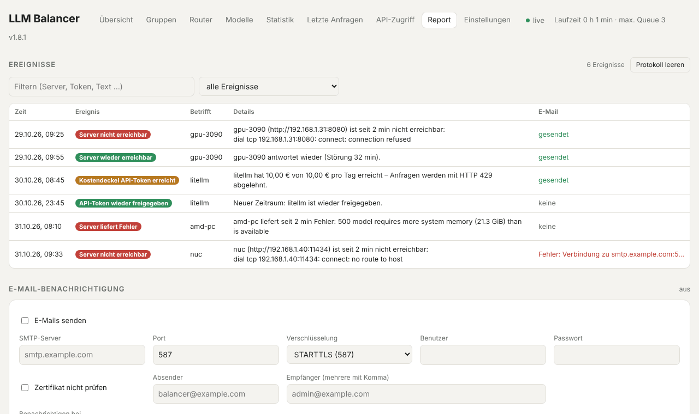

### Einstellungen

**Mein Konto** (eigenes Passwort ändern), **Benutzer** mit Rollen – *Administrator* darf alles, *Operator* darf Server
und Gruppen an-/ausschalten und Anfragen stoppen, *Betrachter* nur lesen – sowie **Konfiguration** exportieren und
importieren. Solange es keinen Benutzer gibt, ist die Web-UI offen; hier wird dann der erste Administrator angelegt.

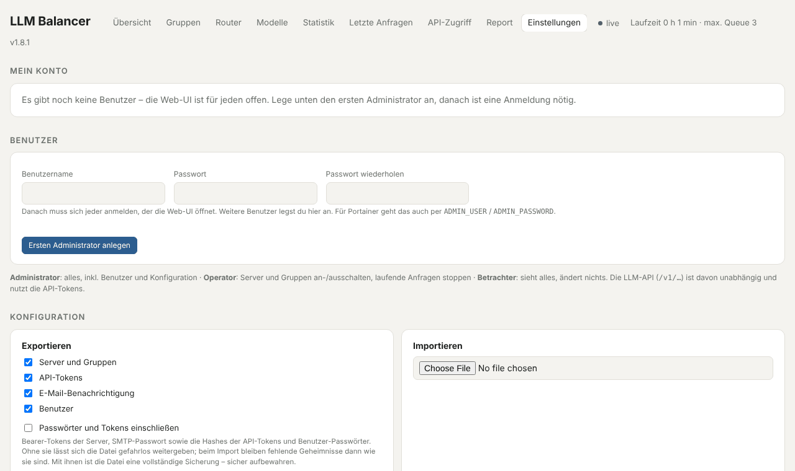

## Konfiguration

### Server-Liste: Startwert und Änderungen in der UI

`BACKENDS` (bzw. `backends` in `config.json`) ist nur die **Startkonfiguration**. Sobald du die Liste in der
Web-UI änderst, wird sie in `DATA_DIR/backends.json` gespeichert (im Container `/data/backends.json`) und hat ab
dann Vorrang – auch nach Neustarts und Image-Updates, solange `/data` auf einem Volume liegt.
Zurück zu `BACKENDS` geht es per `POST /balancer/api/reset` (löscht die Datei; Gruppen werden dabei aus `config.json` übernommen).

Änderungen wirken sofort:

* Neuer Server oder mehr Slots → wartende Anfragen aus der Queue starten sofort dort.
* Geänderte URL → sofortiger Health-Check; laufende Anfragen auf der alten URL laufen zu Ende.
* Entfernter Server → bekommt keine neuen Anfragen mehr, laufende werden normal beendet.

Zugang zur UI regelt die **Benutzerverwaltung** (siehe unten). Solange es keinen Benutzer gibt, ist die UI offen; mit
`ADMIN_TOKEN` lassen sich dann zumindest Änderungen absichern (die UI fragt einmal nach dem Token).

### Benutzer und Anmeldung

Unter **Einstellungen** legst du den ersten Administrator an (oder per `ADMIN_USER` / `ADMIN_PASSWORD` beim ersten Start).
Ab dann zeigt die Web-UI ohne Anmeldung nur noch das Login – auch die JSON-API unter `/balancer/api/` braucht eine
Anmeldung. Rollen:

| Rolle | darf |
|---|---|
| Administrator | alles, inkl. Benutzer, Konfiguration, Import/Export |
| Operator | alles sehen; Server und Gruppen an-/ausschalten, laufende Anfragen stoppen |
| Betrachter | alles sehen, nichts ändern |

* Passwörter mindestens 8 Zeichen, gespeichert als PBKDF2-SHA256-Hash in `/data/users.json`; Sitzungen (Cookie, 30 Tage)
  in `/data/sessions.json`, sie überstehen also ein Container-Update
* jeder ändert sein Passwort unter Einstellungen → Mein Konto; neues Passwort / Sperren beendet die anderen Sitzungen
* der letzte aktive Administrator kann nicht gelöscht, gesperrt oder herabgestuft werden
* nach 5 Fehlversuchen von einer IP ist die Anmeldung dort 5 Minuten gesperrt
* `ADMIN_TOKEN` (Header `X-Admin-Token`) funktioniert weiter als Administrator-Zugang für Skripte
* ohne Anmeldung erreichbar bleiben: die LLM-API (`/v1/…`, mit API-Tokens), `/balancer/healthz` und `/balancer/metrics`
* Passwort vergessen und kein zweiter Admin: Container stoppen, `/data/users.json` löschen – danach ist die UI wieder offen
  bzw. `ADMIN_USER`/`ADMIN_PASSWORD` legt den Admin neu an

### Konfiguration sichern und übertragen

Einstellungen → **Konfiguration**: Export als JSON-Datei mit wählbaren Bereichen – Server und Gruppen, API-Tokens,
E-Mail-Benachrichtigung, Benutzer. **Passwörter und Tokens** (Bearer-Tokens der Server, SMTP-Passwort, Hashes der
API-Tokens und Benutzer-Passwörter) kommen nur mit, wenn angehakt – dann ist die Datei eine vollständige Sicherung und
muss geschützt werden. Beim **Import** zeigt die UI, was in der Datei steht; die gewählten Bereiche werden ersetzt.
Fehlt ein Geheimnis in der Datei, bleibt das bisherige des Eintrags mit gleichem Namen erhalten. Ein Import, nach dem es
keinen aktiven Administrator mehr gäbe, wird abgelehnt. Statistik und Zähler bleiben unberührt.

Für einen Bind-Mount statt eines Docker-Volumes muss der Ordner dem User 65534 gehören
(`chown 65534:65534 ./data`), sonst kann der Container nicht speichern – die UI zeigt das dann als Warnung an.

### Servergruppen und Modelle

Eine Gruppe ist eine Menge von Servern plus die Modelle, die sie bedienen. Ein Server gehört zu höchstens einer Gruppe
(Dialog „Bearbeiten“ des Servers oder Dialog der Gruppe). Die Zuordnung einer Anfrage passiert über das Feld `model`:

1. Gruppen, deren Modellliste passt – eingetragene Namen oder Muster mit `*` (z. B. `qwen3*`), und, wenn
   „zusätzlich gemeldete Modelle“ aktiv ist (Standard), alle Modelle ihrer Server (gemeldet oder im Filter des Servers).
   Passen mehrere Gruppen, zählen die Server aller passenden Gruppen.
   **Innerhalb der Gruppe** bekommen nur die Server die Anfrage, die das Modell haben; sind sie belegt, wartet die
   Anfrage auf sie. Kennt keiner der Server das Modell (z. B. nur über das Muster der Gruppe), darf es die ganze Gruppe.
2. Sonst: alle Server, die das Modell selbst haben (auch ohne Gruppe).
3. Sonst: alle Server – oder 404, wenn `UNKNOWN_MODEL=reject` gesetzt ist.

**Exakt vor Muster:** Ein Modell, das exakt bekannt ist – vom Server gemeldet oder ohne `*` eingetragen – hat Vorrang vor
Treffern über `*`, sowohl bei der Wahl der Gruppe als auch des Servers. Beispiel: Gruppe A hat `qwen*`, ein Server in
Gruppe B meldet `qwen3-32b` → eine Anfrage für `qwen3-32b` geht nur nach B; `qwen2.5-7b` (kennt niemand exakt) nach A.

**Modellfilter pro Server** (Dialog „Bearbeiten“): Namen oder Muster, die der Server bedient, eins pro Zeile – für Server,
die keine Modellliste liefern, oder um die Zuordnung festzulegen. Mit „zusätzlich die vom Server gemeldeten Modelle“
(Standard an) zählen auch die per `/v1/models` gemeldeten; ausgeschaltet gilt nur der Filter. Auf der Karte erscheinen
Filter-Einträge farbig hinterlegt (Muster gestrichelt), gemeldete Modelle grau.

**Modell erzwingen pro Server**: optionaler Modellname, der statt des angefragten gesendet wird, wenn der Server dieses
nicht exakt kennt – etwa bei Filter `qwen*` und Ersatz `qwen3:8b`: eine Anfrage für `qwen2.5-72b` kommt dort als
`qwen3:8b` an, exakt gemeldete oder eingetragene Modelle gehen unverändert durch. Greift nach „Modellname erzwingen“ der
Gruppe bzw. „Modell dort“ der Fallback-Gruppe, falls der Server auch deren Ergebnis nicht kennt. In „Letzte Anfragen“
erscheint das als `qwen2.5-72b → qwen3:8b`.

Groß-/Kleinschreibung spielt keine Rolle. Die Modelle der Server werden beim Health-Check (alle 15 s, nur bei freien Servern)
neu abgefragt. Im Feld **Modell** über der Serverliste lässt sich ein Modell auswählen: die UI zeigt dann, welche Gruppe
und welche Server es bekommen, und blendet die übrigen Server aus. `GET /balancer/api/route?model=…` liefert dasselbe als JSON.

Ohne Gruppen verhält sich der Balancer wie bisher (alle Server bedienen alle Modelle).

### Was wird wann gespeichert?

Alles liegt im Volume `/data` (`DATA_DIR`):

| Datei | Inhalt | Geschrieben |
|---|---|---|
| `backends.json` | Server, Gruppen, Server-Tokens | sofort bei jeder Änderung |
| `access.json` | API-Tokens (Hash), Preise, verbrauchte Tokens und Kosten | sofort bei Änderungen, Zähler jede Minute |
| `stats.json` | Tagesstatistik pro Server, Modell und API-Token | jede Minute |
| `counters.json` | Zähler der Server-Karten (Anfragen, Fehler, Ø Dauer, tok/s, Tag-Fehler, letzter Fehler) und der Kacheln oben | jede Minute |

Minütlich wird nur geschrieben, was sich geändert hat, jeweils über eine temporäre Datei und Umbenennen (kein halb
geschriebener Stand nach einem Absturz). Beim Stoppen (SIGTERM) schreibt der Balancer sofort alles, wartet dann bis zu 30 s
auf laufende Anfragen und schreibt danach noch einmal. Damit Docker so lange wartet, steht in der Stack-Vorlage
`stop_grace_period: 40s` (Docker-Standard sind 10 s; ohne die Zeile gehen nur die Anfragen verloren, die beim Stoppen noch liefen).
Nach einem Absturz oder Stromausfall fehlt höchstens die letzte Minute. Nur die Liste „Letzte Anfragen“ liegt ausschließlich
im Speicher. „Statistik löschen“ setzt auch die Zähler der Server-Karten und Kacheln zurück.

### Modellname erzwingen

Pro Gruppe lässt sich ein Modellname eintragen, der an die Server der Gruppe geschickt wird – egal welcher Name angefragt
wurde (z. B. weil Ollama auf einem Server `qwen3:32b-q4_K_M` heißt, die Clients aber `qwen3-32b` anfragen). Die Zuordnung
zur Gruppe läuft weiter über den angefragten Namen; mit dem Muster `*` nimmt die Gruppe jedes Modell an. Übernimmt ein
Server der Gruppe eine Anfrage als Fallback, gilt das „Modell dort“ der Fallback-Einstellung, falls gesetzt, sonst der
erzwungene Name dieser Gruppe. In „Letzte Anfragen“ steht der angefragte und der tatsächlich gesendete Name.

### Was passiert, wenn ein Server einen Fehler liefert?

1. Antwortet ein Server mit einem Fehler, versucht der Balancer **einen anderen Server derselben Gruppe**
   (bzw. – ohne Gruppen – einen anderen passenden Server). Ist der gerade belegt, wartet die Anfrage an der Spitze der Queue.
2. Sind **alle Server der Gruppe** fehlgeschlagen (oder down), geht die Anfrage an die **Fallback-Gruppe** – sofort,
   ohne die eingestellte Wartezeit abzuwarten.
3. Ist auch die Fallback-Gruppe erschöpft (oder keine eingestellt), darf **jeder andere Server, der das Modell selbst meldet**
   (`/v1/models`), die Anfrage übernehmen – auch aus einer anderen Gruppe.
4. Erst wenn auch dort alle Server scheitern, bekommt der Client **die letzte echte Fehlerantwort** (Statuscode und Text
   des Servers, Header `X-LLM-Balancer-Attempts`). Waren alle Server unerreichbar, kommt HTTP 502 mit allen Verbindungsfehlern.

Anfragen ohne Slot (z. B. `GET`) gehen an einen Server und bei einer Fehlerantwort an den nächsten.
`GET /v1/models/<modell>` beantwortet der Balancer selbst aus den Modellen aller Server. Welche Version läuft, steht oben
in der Web-UI (z. B. `v1.0.1`, Commit im Tooltip) und in der ersten Log-Zeile; Änderungen stehen in `CHANGELOG.md`.

Jeder Server wird pro Anfrage höchstens einmal versucht. Als Fehler gelten Verbindungsfehler, **jeder Statuscode ab 400**
(auch 400 „Kontext zu groß“ – ein Server mit mehr Kontext kann es schaffen) und **Antworten mit HTTP 200, deren Anfang ein
Fehler ist** (llama.cpp schickt ein SSE-Event `{"error":…}`, Ollama eine Fehlerzeile) oder die leer sind: Der Balancer prüft
den Anfang jeder Antwort, bevor er etwas an den Client schickt – das verzögert nichts, der erste Token geht sofort durch.
Mit `RETRY_STATUS=404,429` (Liste) werden nur 5xx und die genannten Codes wiederholt, andere 4xx sofort durchgereicht. Ein Server, der nur
„belegt“ meldet (503/429), zählt nicht als fehlerhaft und darf dieselbe Anfrage wieder bekommen, sobald er frei ist.
Läuft die Antwort schon (Stream begonnen), ist kein Wechsel mehr möglich. In „Letzte Anfragen“ zeigt `↻ 3×` mit Tooltip
den Weg, z. B. `gpu: 500 → amd: 503 → nuc (Fallback): 200`; fehlgeschlagene Versuche zählen beim jeweiligen Server als Fehler.

### Fallback-Gruppe

Im Dialog einer Gruppe lassen sich eine **Fallback-Gruppe**, eine **Wartezeit** und optional ein **Modell dort** einstellen.
Wartet eine Anfrage dieser Gruppe länger als die Wartezeit in der Queue, dürfen zusätzlich die Server der Fallback-Gruppe
sie übernehmen – ein freier Server der eigenen Gruppe hat dabei immer Vorrang. Sind alle Server der Gruppe down oder
deaktiviert, wird sofort auf die Fallback-Gruppe ausgewichen. Mit „Modell dort“ ersetzt der Balancer das Feld `model`
der Anfrage für den Fallback-Server (z. B. `qwen3-32b` → `llama3.2:3b`), sonst geht der Modellname unverändert durch.
Die Queue wird jede Sekunde neu geprüft. In „Letzte Anfragen“ erscheint so eine Anfrage als `qwen-gross → klein` und
`qwen3-32b → llama3.2:3b`. Der Fallback reicht eine Stufe weit (der Fallback des Fallbacks wird nicht verwendet).

Eine Gruppe lässt sich auf der Seite Gruppen **deaktivieren**: ihre Server bekommen dann keine neuen Anfragen (laufende
laufen zu Ende, die Server erscheinen als „Gruppe aus“), Anfragen für die Gruppe gehen sofort an die Fallback-Gruppe –
auch die, die schon warten. Ohne Fallback gehen sie an andere Server, die das Modell selbst melden.

### Modell-Router

Ein Router sitzt zwischen Anfrage und Gruppe: er wählt anhand von Regeln das Modell, danach geht es wie gewohnt an die
passende Gruppe und den Server, der das Modell hat (Seite **Router**, `#router`).

* **Virtuelles Modell**: der Name des Routers, z. B. `auto` – Clients fragen `"model": "auto"` an, er steht in `/v1/models`.
* **Übernommene Modelle**: optional Namen/Muster echter Modelle (z. B. `gpt-4*`), die der Router ebenfalls umleitet.
* **Regeln** von oben nach unten, die erste passende gewinnt; alle gesetzten Bedingungen müssen zutreffen:
  geschätzte Prompt-Tokens (ab/bis), Bilder, Tools, JSON-Antwort, Denken angefordert (`reasoning_effort`, `think` …),
  Text-Muster (Regex) in letzter Nachricht / System-Prompt / allem, API-Token, Client-IP/CIDR, Header, Länge der
  Warteschlange, „wenn Modell X belegt“ und Uhrzeit (z. B. `22-6`).
* **Ziel** einer Regel ist ein Modell – oder „ein Modell mit Bilder / Tools / Denken / genug Kontext“; dann nimmt der
  Router das passende Modell, bevorzugt eins mit freiem Server.
* **Mehrere gleichwertige Zielmodelle**: Regel-Ziel, Standardmodell, Stufen und Routen nehmen auch Listen
  (`qwen3:30b-a3b, qwen3:32b`). Die Anfrage geht an den ersten freien Server, der eins davon hat (bei mehreren freien an
  das weiter vorne genannte Modell); sind alle belegt, wartet sie auf den, der zuerst frei wird. Der Modellname in der
  Anfrage wird passend zum Server gesetzt.
* **Standardmodell**, wenn keine Regel passt (leer: übernommene echte Modelle bleiben unverändert).
* **Fähigkeiten beachten** (Standard an): kann das gewählte Modell nachweislich etwas nicht, was die Anfrage braucht
  (Bilder, Tools, Kontext), weicht der Router auf ein fähiges Modell aus.
* **Session-Bindung** (optional): eine Unterhaltung bzw. ein Agenten-Lauf bleibt beim zuerst gewählten Modell (2 h ohne
  Anfrage, dann neu) – wichtig für Agenten wie Hermes, damit das Modell nicht mitten im Lauf wechselt.
* In „Letzte Anfragen“ erscheint z. B. `auto → qwen3-coder:30b ⑂` (Tooltip: Router und Regel); die Router-Seite zeigt die
  Treffer pro Regel und hat einen **Test**: Anfrage einfügen, sehen, welche Regel welches Modell wählen würde und warum
  die anderen nicht passen.

**Wenn keine Regel passt** entscheidet wahlweise ein Klassifizierer (angelehnt an LiteLLMs Auto Routing):

| Klassifizierer | wie | Ergebnis |
|---|---|---|
| Heuristik | Score aus Länge, Code, Reasoning-Markern, Fachbegriffen, einfachen Fragen, mehrstufigen Aufträgen, Fragezeichen (Gewichte wie LiteLLM, deutsch + englisch); 2+ Reasoning-Marker → REASONING; kein Modellaufruf | Stufe |
| LLM | ein kleines Modell (z. B. `qwen3:0.6b`) ordnet die letzte Anfrage (mit bis zu N früheren als Kontext) einer Stufe zu; Anweisung anpassbar | Stufe |
| Arch-Router | [katanemo/Arch-Router-1.5B](https://huggingface.co/katanemo/Arch-Router-1.5B), z. B. `arch-router:1.5b` in Ollama, wählt eine von dir beschriebene Route (Name + Beschreibung → Modell); „other“ → Standardmodell | Route |

* **Stufen** SIMPLE / MEDIUM / COMPLEX / REASONING mit je einem oder mehreren Modellen (das erste mit freiem Server);
  eine leere Stufe geht an die nächsthöhere. Regeln können statt eines Modells auch eine Stufe als Ziel haben (wie
  LiteLLMs `keyword_tier_rules`).
* Der Klassifizierer läuft **am Slot-System vorbei** direkt auf einem Server mit dem Modell (oder dem eingestellten), damit
  er nicht auf das große Modell wartet; Ollama hält ihn 30 min geladen (`OLLAMA_MAX_LOADED_MODELS` ≥ 2 empfohlen).
  Timeout einstellbar (Standard 5 s); bei Fehler oder Timeout gilt das Standardmodell oder die Heuristik.
* Mit Session-Bindung wird nur die erste Anfrage einer Unterhaltung klassifiziert.
* Systemhinweise (`<system-reminder>`), System-Prompt und reine Tool-Ausgaben werden für die Einordnung ignoriert.
* Der Test auf der Router-Seite ruft den Klassifizierer wirklich auf und zeigt Ergebnis und Dauer.

**Modell-Fähigkeiten** pro Server (Dialog „Bearbeiten“): Bilder, Tools, Denken und Kontextlänge pro Modell oder Muster.
Bei Ollama-Servern werden sie aus `/api/show` erkannt (Kontext = maximale Länge des Modells, nicht das eingestellte
`num_ctx` – bei Bedarf hier überschreiben). Die Seite Modelle zeigt sie mit an.

### Ollama

Server haben einen **Typ**: „automatisch erkennen“ (Standard – ein Server, der `GET /api/version` beantwortet, gilt als
Ollama), „OpenAI-kompatibel“ oder „Ollama“. Ollama-Server zeigen auf der Karte ein Badge mit der Version, im Speicher
geladene Modelle einen grünen Punkt; ihre Modellliste kommt aus `/api/tags`.

* OpenAI-Anfragen (`/v1/chat/completions` …) gehen wie bisher an alle passenden Server – Ollama versteht sie selbst.
* Die **native Ollama-API** am Balancer: `/api/chat`, `/api/generate`, `/api/embed`, `/api/embeddings` laufen durch die
  Slot-Verwaltung, Gruppen und Fallbacks, aber nur zu Ollama-Servern. `GET /api/tags`, `/api/ps` und `/api/version`
  beantwortet der Balancer mit den Modellen aller Ollama-Server – so lässt sich z. B. Open WebUI direkt auf den Balancer
  als „Ollama“ zeigen. `/api/show` geht ohne Slot durch. Modellverwaltung über diese API (`/api/pull`, `/api/delete`,
  `/api/create`, `/api/copy`, `/api/push`) lehnt der Balancer mit 403 ab – dafür gibt es die Seite Modelle.

**Seite Modelle** (`#modelle`): alle Modelle aller Ollama-Server live mit Größe, Parametern, Quantisierung, Familie,
Änderungsdatum und ob sie gerade im Speicher sind (VRAM, „teilw. CPU“, Ablaufzeit), filter- und sortierbar.

* **Herunterladen**: Name wie auf ollama.com/library oder `hf.co/<nutzer>/<repo>:<quant>`, auf einen oder mehrere
  Server gleichzeitig; Fortschritt mit Balken, abbrechbar. Der Download läuft im Balancer, nicht im Browser.
* **Kopieren …**: dasselbe Modell auf Server laden, denen es noch fehlt
* **Löschen** (Administrator) und **Entladen** aus dem Speicher (Operator)
* Bearer-Tokens der Server werden auch hier verwendet

### Sessions

Agenten wie Hermes schicken bei jedem Schritt die ganze Unterhaltung mit. „Letzte Anfragen“ zeigt deshalb pro Anfrage eine
kurze Session-Kennung (8 Zeichen, Klick filtert darauf). Ermittelt wird sie in dieser Reihenfolge:

1. eine vom Client mitgeschickte ID: Header `X-Session-Id`, `Session-Id`, `X-Conversation-Id`, `X-Thread-Id`, `X-Chat-Id`
   oder ein Feld im Body (`session_id`, `conversation_id`, `thread_id`, `chat_id`, `metadata.session_id`,
   `metadata.user_id` (Anthropic), `prompt_cache_key`, `user` …)
2. sonst ein Fingerabdruck aus System-Prompt und erster Nutzer-Nachricht – gleich für alle Schritte einer Unterhaltung,
   verschieden für zwei Aufgaben, auch wenn sie vom gleichen API-Token und Rechner kommen

Die Kennung ist ein Hash (zusammen mit dem API-Token), die eigentliche ID oder der Text wird nicht angezeigt. Der Tooltip
nennt die Quelle. Startet ein Agent mit identischem Prompt neu, landen beide Läufe in derselben Session.

### Tagesansicht und Warteschlange

Unter Statistik → **Tag**: pro Stunde der Anteil der Slot-Zeit, in der die Server gerechnet haben (Balken = heute, Linie =
Ø der letzten 7 Tage mit Daten), umschaltbar auf Anfragen und wartende Anfragen pro Stunde, für alle Server oder einen.
Dazu: Auslastung jetzt (belegte Slots), heute bis jetzt im Vergleich zum Ø der Vortage bis zur gleichen Uhrzeit, Ø ganzer
Tag und eine Tabelle pro Server. Die Stundenwerte werden 62 Tage aufgehoben (in `stats.json`). Die Tabelle
**Warteschlange** zeigt pro Tag: Anfragen, wie viele mindestens 0,25 s warten mussten, Ø/max. Wartezeit, maximale Länge
der Queue und abgelehnte Anfragen.

### Prüfung der Tags im generierten Text

Der Balancer liest den Text mit, den das Modell erzeugt (Streams und normale Antworten, OpenAI-, Anthropic- und Ollama-Format),
und prüft, ob Tags korrekt geöffnet und geschlossen werden. Gemeldet werden: nicht geschlossene Tags, schließende Tags ohne
öffnendes, falsche Reihenfolge (`<a><b></a></b>`) und ein noch offenes Tag, das erneut geöffnet wird. Standardmäßig geprüft
werden `think, thinking, reasoning, tool_call, tool_calls, function_call, answer` (`TAG_CHECK`, `*` = alle Tags, `off` = aus);
anderes HTML in Antworten wird ignoriert. Ein `</think>` ohne öffnendes Tag am Anfang der Antwort gilt nicht als Fehler,
weil Chat-Templates von Reasoning-Modellen (Qwen3, DeepSeek-R1) das `<think>` in den Prompt schreiben. Bricht ein Stream
vorzeitig ab, werden offene Tags nicht gemeldet. Fehler stehen in „Letzte Anfragen“ (Filter „nur Antworten mit Tag-Fehlern“),
als Zähler auf der Server-Karte und in der Statistik pro Server und Modell. Der Inhalt wird nicht gespeichert.

### Tokens pro Sekunde

Pro Anfrage: Antwort-Tokens geteilt durch die Zeit vom ersten Byte bis zum Ende (Generierung) und Prompt-Tokens geteilt durch
die Zeit bis zum ersten Byte (Prompt-Verarbeitung) – nur bei Streams mit Token-Angaben. Die Server-Karte zeigt den
Durchschnitt, den letzten Wert und die Prompt-Geschwindigkeit; laufende Anfragen zeigen einen Live-Schätzwert
(≈ ein Token pro gestreamtem Chunk). Die Statistik zeigt Ø tok/s pro Server, Modell und Tag.

### Anfragen stoppen

Der Knopf **■ Stop** auf der Server-Karte (bzw. ■ in der Listenansicht) bricht die laufende Anfrage dieses Servers nach
einer Rückfrage sofort ab. Der Balancer schließt dabei die Verbindung zum LLM-Server – llama.cpp, Ollama und vLLM beenden
die Generierung dann von selbst – und der Slot wird sofort frei für die nächste Anfrage aus der Warteschlange.
Der Client bekommt eine Fehlermeldung: läuft der Stream schon, ein letztes SSE-Event
`{"error":{"message":"llm-balancer: request stopped by administrator"}}`, sonst HTTP 499 mit derselben Meldung
(499 statt 5xx, damit OpenAI-Clients und LiteLLM die Anfrage nicht automatisch wiederholen). Gestoppte Anfragen zählen als
„abgebrochen“, nicht als Fehler des Servers. Per API: `POST /balancer/api/backends/{name}/stop` (alle laufenden Anfragen
des Servers) oder `POST /balancer/api/requests/{id}/stop` (eine Anfrage, auch wartende).

**„Ein“ und „Aus“ immer aus Sicht dessen, um den es geht:** Bei API-Tokens aus Sicht der Anwendung – *Aus* = Prompt,
den sie sendet, *Ein* = Antwort, die sie bekommt. Bei Servern (und Modellen) aus Sicht des Servers – *Ein* = Prompt, den
er bekommt, *Aus* = Antwort, die er erzeugt. Jede Spalte nennt zusätzlich „Prompt“ bzw. „Antwort“; der CSV-Export heißt
`Tokens_Prompt` / `Tokens_Antwort`.

### Kostendeckel

* **API-Token** (Tab API-Zugriff → Bearbeiten): Deckel für die eingehenden Kosten pro Tag, Monat oder gesamt. Ist er
  erreicht, lehnt der Balancer Anfragen mit dem Token mit HTTP 429 (`insufficient_quota`, wie OpenAI bei aufgebrauchtem
  Guthaben) ab. Im nächsten Tag/Monat oder nach Erhöhen des Deckels ist der Token automatisch wieder frei. Zusätzlich
  kann ein Token mit „Sperren“ manuell abgeschaltet werden (HTTP 403).
* **Server** (Server-Dialog): Deckel für die ausgehenden Kosten. Ist er erreicht, bekommt der Server keine Anfragen mehr
  (Zustand „Kostendeckel“) und Anfragen gehen an die übrigen Server bzw. die Fallback-Gruppe – auch solche, die schon
  warten. Laufende Anfragen werden zu Ende bearbeitet; dadurch kann der Deckel um die letzte Anfrage überschritten werden.

Die Kosten pro Tag/Monat kommen aus der Tagesstatistik (Zeitzone `TZ`); „gesamt“ bei Servern umfasst den
Statistikzeitraum (`STATS_DAYS`), bei Tokens die „Einnahmen gesamt“. „Statistik löschen“ setzt damit auch die Deckel zurück.

### Report und E-Mail-Benachrichtigung

Der Tab **Report** zeigt alle Ereignisse (Server nicht erreichbar / liefert Fehler / wieder da, Kostendeckel erreicht /
wieder frei) und enthält die Einstellungen für E-Mails: SMTP-Server, Port, Verschlüsselung (STARTTLS, SSL/TLS, keine),
Anmeldung, Absender, Empfänger, welche Ereignisse eine Mail auslösen, und nach wie vielen Sekunden eine Störung gemeldet
wird – kurze Aussetzer lösen so keine Mail aus. Pro Störung gibt es eine Mail und eine, wenn sie vorbei ist. Mit
„Testmail senden“ lässt sich die Verbindung prüfen. Gespeichert wird in `/data/notify.json` (inkl. Passwort, Dateirechte
0600; das Passwort wird nie an die UI zurückgegeben), das Protokoll in `/data/events.json` (letzte 300 Ereignisse).
Der Container muss den SMTP-Server erreichen können (Port 587/465/25).

### Eingehende und ausgehende Preise

* **Eingehend (API-Tokens):** was ein Client pro 1 Mio. Tokens bezahlt – Tab API-Zugriff → „Bearbeiten“.
* **Ausgehend (Server):** was ein Server pro 1 Mio. Tokens kostet (Strom, Hardware, bezahlter Anbieter) –
  im Dialog „Bearbeiten“ des Servers.

Pro Anfrage werden beide Beträge berechnet („Einnahme“ und „Kosten Server“ in Letzte Anfragen). Die Statistik zeigt pro
Server, Modell und Tag **Einnahmen**, **Kosten Server** und den **Saldo**; der CSV-Export enthält beide Spalten.

### Token-Zählung und Preise

Der Balancer liest die Token-Angaben aus den Antworten: `usage` (OpenAI, auch im letzten Stream-Chunk), `input_tokens` /
`output_tokens` (Anthropic), `prompt_eval_count` / `eval_count` (Ollama nativ) und `timings` (llama.cpp). Damit
OpenAI-kompatible Server auch bei Streams Zahlen liefern, ergänzt der Balancer Stream-Anfragen an `…/completions` um
`"stream_options": {"include_usage": true}`, sofern der Client das nicht selbst setzt (abschaltbar mit `STREAM_USAGE=false`;
der Client erhält dann einen zusätzlichen letzten Chunk mit `usage` und leerem `choices`).

Pro API-Token lässt sich unter **API-Zugriff → Bearbeiten** ein Preis pro 1 Mio. Prompt- und Antwort-Tokens hinterlegen
(Währung über `CURRENCY`). Die Kosten werden beim Abschluss jeder Anfrage mit dem dann gültigen Preis berechnet; eine
Preisänderung rechnet bereits gezählte Kosten nicht um. Die Statistik zeigt Tokens pro Server und Tag sowie Anfragen,
Tokens und Kosten pro API-Token im gewählten Zeitraum; „Letzte Anfragen“ zeigt Tokens, Tokens/s und Kosten jeder Anfrage
(die letzten 300, davon 15 sichtbar, der Rest per Scrollen).

### Tokens

**Bearbeiten** eines API-Tokens (Seite API-Zugriff): Name, **erlaubte Modelle** (Namen oder Muster mit `*`, leer = alle),
Preise, Kostendeckel und auf Wunsch ein neuer Token-Wert. Ist eine Modellliste gesetzt, lehnt der Balancer andere Modelle
mit HTTP 403 `model_not_allowed` ab, und `/v1/models` bzw. `/api/tags` zeigen diesem Token nur die erlaubten. Geprüft wird
das angefragte Modell – ein erlaubtes virtuelles Router-Modell wie `auto` darf auf jedes Modell geroutet werden.
Bei Tokens aus `API_KEYS` lassen sich Modelle, Preise und Deckel ändern, Name und Wert nur in der Variable.

**Zugriff auf den Balancer (Clients → Balancer).** Sobald mindestens ein Token existiert, brauchen alle Anfragen an die
LLM-API (alles außerhalb von `/balancer/`) einen gültigen Token als `Authorization: Bearer <token>`, `x-api-key` oder `api-key`.
Sonst antwortet der Balancer mit 401 im OpenAI-Fehlerformat. Tokens kommen aus `API_KEYS` (fest, nur per Umgebungsvariable
änderbar) oder werden in der UI unter **API-Zugriff** erzeugt. Ein erzeugter Token wird genau einmal angezeigt; gespeichert
wird nur sein SHA-256-Hash in `/data/access.json`. Die UI zeigt pro Token „zuletzt benutzt“ und die Anzahl Anfragen, in
„Letzte Anfragen“ steht der Token-Name als Client. Ohne jeden Token ist die API offen (die UI weist darauf hin).

**Tokens der LLM-Server (Balancer → Server).** Pro Server kann ein Bearer-Token hinterlegt werden (Dialog „Bearbeiten“
oder `BACKEND_KEYS="gpu=sk-…"` als Startwert). Er wird als `Authorization: Bearer …` gesendet, auch beim Health-Check.
Die Zugangsdaten des Clients werden nie an die Server weitergegeben, sobald der Balancer selbst Tokens prüft oder der Server
einen eigenen Token hat. Lehnt ein Server den Token ab (401/403), wird er als *fehlerhaft* bzw. beim Health-Check als *down*
mit entsprechendem Hinweis angezeigt. Server-Tokens verlassen den Balancer nie über API oder UI und liegen in
`/data/backends.json` (Dateirechte 0600).

### Alle Optionen

Entweder per Umgebungsvariablen oder per `config.json` (Pfad über `CONFIG`, sonst `./config.json` bzw.
`/config/config.json`). Umgebungsvariablen überschreiben die Datei. Siehe `config.example.json`.

| Variable / Feld | Standard | Bedeutung |
|---|---|---|
| `BACKENDS` / `backends` | – | Startkonfiguration: `name=url*maxParallel@priorität`, kommagetrennt. Name, `*N` und `@N` sind optional. Darf leer sein, wenn alles in der UI eingetragen wird |
| `DATA_DIR` / `data_dir` | `data` (Docker: `/data`) | Ablage für die in der UI geänderte Server-Liste |
| `STATS_DAYS` / `stats_days` | `400` | Aufbewahrung der Tagesstatistik |
| `TZ` | UTC | Zeitzone für die Tagesgrenzen der Statistik, z. B. `Europe/Berlin` |
| `API_KEYS` / `api_keys` | – | Tokens für Clients der LLM-API: `name=token,…` (oder nur `token,…`) |
| `BACKEND_KEYS` | – | Startwerte für die Bearer-Tokens der Server: `name=token,…` |
| `UNKNOWN_MODEL` / `unknown_model` | `all` | `reject`: Modelle, die keine Gruppe und kein Server kennt, mit 404 ablehnen (nur wenn Gruppen existieren) |
| `STREAM_USAGE` / `stream_usage` | `true` | Stream-Anfragen um `stream_options.include_usage` ergänzen, damit Tokens gezählt werden |
| `CURRENCY` / `currency` | `€` | Währung der Preise |
| `RETRY_STATUS` / `retry_status` | `all` | `all`: jeder Fehler ab 400 wird auf anderen Servern wiederholt; Liste (z. B. `404,429`): nur 5xx und diese Codes |
| `TAG_CHECK` / `tag_check` | `think,thinking,reasoning,tool_call,tool_calls,function_call,answer` | Geprüfte Tags im generierten Text; `*` = alle, `off` = aus |
| `DNS_SERVERS` / `dns_servers` | – | DNS-Server (IPs, optional mit Port) für die Namen der LLM-Server; danach Fallback auf den Container-Resolver |
| `ADMIN_TOKEN` / `admin_token` | – | Ohne Benutzer: Änderungen in UI/API nur mit diesem Token. Mit Benutzern: Administrator-Zugang für Skripte (Header `X-Admin-Token`) |
| `ADMIN_USER` / `ADMIN_PASSWORD` | – | legt beim Start einen Administrator an, falls es noch keinen Benutzer gibt |
| `LISTEN` / `listen` | `:8080` | Listen-Adresse |
| `QUEUE_TIMEOUT_SEC` / `queue_timeout_sec` | `900` | Max. Wartezeit in der Queue (0 = unbegrenzt), danach HTTP 504 |
| `MAX_QUEUE` / `max_queue` | `0` | Max. Länge der Queue (0 = unbegrenzt), danach HTTP 503 |
| `HEALTH_PATH` / `health_path` | `/v1/models` | Pfad für Health-Checks; leer = deaktiviert (dann 10 s Sperre nach Verbindungsfehler). Für llama.cpp passt auch `/health` |
| `HEALTH_INTERVAL_SEC` / `health_interval_sec` | `15` | Intervall der Health-Checks |
| `slot_methods` | `["POST"]` | HTTP-Methoden, die einen Slot belegen |
| `retry_status` | `[503]` | Upstream-Statuscodes, bei denen auf einen anderen Server ausgewichen wird |
| `ui_prefix` | `/balancer` | Pfad der Web-UI/API (alles andere wird durchgereicht) |

Beispiel mit einem Server, der 2 parallele Anfragen kann (z. B. llama.cpp mit `-np 2`), und Bevorzugung der GPU:

```
BACKENDS="gpu=http://10.0.0.5:8080*2@0,amd=http://10.0.0.6:8080@1"
```

## LiteLLM anbinden

Statt mehrerer Deployments mit Zufallsverteilung nur noch **ein** Deployment, das auf den Balancer zeigt:

```yaml
model_list:
  - model_name: local-llm
    litellm_params:
      model: openai/qwen3          # Modellname wird 1:1 an den Backend-Server weitergegeben
      api_base: http://llm-balancer:8080/v1
      api_key: "llmb-…"            # Token aus API_KEYS bzw. „API-Zugriff“ in der UI ("none", wenn keiner eingerichtet ist)
      timeout: 1800                # Queue-Wartezeit + Generierungsdauer einplanen
      stream_timeout: 1800
```

Hinweise:

* Der Modellname wird nicht umgeschrieben. Die Backends müssen den Namen also entweder alle kennen
  (Ollama: gleiches Modell-Tag) oder ihn ignorieren (llama.cpp-Server mit einem geladenen Modell).
* LiteLLM-Timeouts und Retries so wählen, dass Anfragen nicht abgebrochen werden, während sie in der Queue warten –
  sonst schickt LiteLLM Duplikate hinterher. Ein vom Client abgebrochener Request wird sauber aus der Queue entfernt
  bzw. sein Slot sofort freigegeben.
* Jede Antwort enthält den Header `X-LLM-Balancer-Backend` mit dem verwendeten Server.

## Web-UI und API

Die Bedienung der Web-UI ist im Abschnitt [Bedienung](#bedienung) beschrieben. Jede Antwort enthält den Header
`X-LLM-Balancer-Backend` mit dem verwendeten Server.

### API

| Methode | Pfad | |
|---|---|---|
| GET | `/balancer/api/status` | kompletter Status |
| GET | `/balancer/api/backends` | aktuelle Server-Liste |
| POST | `/balancer/api/backends` | Server hinzufügen, Body `{"name","url","type","max_concurrent","priority","enabled","api_key","group","models":[…],"auto_models","force_model"}` (`type`: `auto`, `openai`, `ollama`), dazu `"features":[{"model":"gemma3*","vision":true,"tools":false,"reasoning":false,"context":131072}]` |
| PUT | `/balancer/api/backends/{name}` | Server ändern (gleicher Body, Umbenennen erlaubt; `api_key` weglassen = behalten, `""` = entfernen) |
| DELETE | `/balancer/api/backends/{name}` | Server entfernen |
| POST | `/balancer/api/backends/{name}/enable` bzw. `/disable` | aktivieren / drain |
| POST | `/balancer/api/backends/{name}/stop` | laufende Anfragen des Servers abbrechen |
| POST | `/balancer/api/requests/{id}/stop` | eine Anfrage (laufend oder wartend) abbrechen |
| POST | `/balancer/api/reset` | zurück zur Startkonfiguration |
| GET/POST | `/balancer/api/tokens` | Client-Tokens auflisten / erzeugen (`{"name","token"?}`) |
| PUT | `/balancer/api/tokens/{name}` | ändern (Felder optional): `{"name","models":["auto","qwen3*"],"price_in":0.4,"price_out":1.6,"cost_cap":10,"cap_period":"month","disabled":false,"token":""}` – `"token":""` erzeugt einen neuen Wert (Antwort `{"token":…}`) |
| DELETE | `/balancer/api/tokens/{name}` | Client-Token löschen |
| POST | `/balancer/api/groups` | Gruppe anlegen: `{"name","models":[…],"auto_models","members":[…],"force_model","fallback","fallback_after_sec","fallback_model"}` |
| PUT / DELETE | `/balancer/api/groups/{name}` | Gruppe ändern (umbenennen erlaubt; `members` / `disabled` weglassen = unverändert) / löschen |
| POST | `/balancer/api/groups/{name}/disable` bzw. `/enable` | Gruppe deaktivieren (Fallback übernimmt) / aktivieren |
| GET | `/balancer/api/route?model=…` | Welche Gruppe/Server bekämen dieses Modell? |
| GET/PUT | `/balancer/api/notify` | E-Mail-Einstellungen (Passwort-Feld weglassen = beibehalten) |
| POST | `/balancer/api/notify/test` | Testmail senden |
| GET | `/balancer/api/events` | Ereignisprotokoll |
| GET | `/balancer/api/recent?after=<seq>` | Letzte Anfragen (max. 300), nur neuere als `seq` |
| GET | `/balancer/api/stats?days=30` | Tagesstatistik pro Server, Modell und API-Token (`&format=csv`, `&by=model` für CSV nach Modell) |
| GET | `/balancer/api/auth/me` | angemeldeter Benutzer / ob Benutzer existieren |
| POST | `/balancer/api/auth/login` · `/logout` · `/setup` · `/password` | Anmelden `{"name","password"}`, Abmelden, ersten Admin anlegen, eigenes Passwort `{"old","new"}` |
| GET/POST | `/balancer/api/users` | Benutzer auflisten / anlegen `{"name","role","password"}` (Rollen `admin`, `operator`, `viewer`) |
| PUT / DELETE | `/balancer/api/users/{name}` | ändern `{"name","role","password","disabled"}` (Felder optional) / löschen |
| GET | `/balancer/api/config/export?sections=servers,tokens,notify,users&secrets=1` | Konfiguration als JSON |
| POST | `/balancer/api/config/import?sections=…` | Konfiguration einspielen (Body = Exportdatei) |
| GET/POST | `/balancer/api/routers` | Router auflisten (mit Treffern) / anlegen `{"name","models":[…],"default","sticky","auto_caps","disabled","rules":[…]}` |
| PUT / DELETE | `/balancer/api/routers/{name}` | Router ändern / löschen; `PUT /balancer/api/routers` ersetzt die ganze Liste |
| | | Router-Felder für Klassifizierer: `"classifier":"heuristic\|llm\|arch"`, `"tiers":{"SIMPLE":[…],…}`, `"routes":[{"name","description","models":[…]}]`, `"class_model"`, `"class_server"`, `"class_timeout_ms"`, `"class_turns"`, `"class_prompt"`, `"class_fallback":"default\|heuristic"`, `"thresholds":[0.15,0.35,0.6]`; Regel-Ziel `"tier"` |
| POST | `/balancer/api/routers/test` | `{"request":{…},"token","client"}` – Entscheidung erklären, ohne etwas auszuführen |
| GET | `/balancer/api/ollama/models` | Modelle und geladene Modelle aller Ollama-Server (live) |
| POST | `/balancer/api/ollama/pull` · `/delete` · `/unload` | `{"model":"qwen3:8b","servers":["gpu1",…]}` – herunterladen (Hintergrund) / löschen / entladen |
| GET | `/balancer/api/ollama/jobs` | laufende und erledigte Downloads mit Fortschritt |
| POST | `/balancer/api/ollama/jobs/{id}/cancel` · `/jobs/clear` | Download abbrechen / erledigte ausblenden |
| GET | `/balancer/api/stats/day?days=7` | Tagesansicht: Stundenwerte heute und Ø der letzten Tage, Warteschlange pro Stunde |
| POST | `/balancer/api/stats/reset` | Statistik löschen |

## Fehlersuche

**`lookup <name> on 127.0.0.11:53: server misbehaving` / `no such host`** – Der Name des Servers lässt sich *im Container*
nicht auflösen (127.0.0.11 ist der DNS-Server, den Docker im Container bereitstellt; er fragt die DNS-Server des Hosts).
Häufige Ursachen: der Name ist nur lokal bekannt (Router, Pi-hole, `/etc/hosts` des Hosts, `.local` per mDNS) oder der
Host nutzt `systemd-resolved` (127.0.0.53), das Docker nicht erreicht. Mit http oder https hat das nichts zu tun.
Abhilfe: `DNS_SERVERS` auf den DNS-Server des Netzes setzen (z. B. `DNS_SERVERS: "192.168.1.1"`, mehrere kommagetrennt).
Der Balancer fragt dann zuerst diese Server und erst danach den Docker-DNS, Namen anderer Container funktionieren also weiter.
Alternativ im Stack `dns:` (gilt für den ganzen Container) oder `extra_hosts: ["name:IP"]`.
Prüfen lässt sich die Auflösung so (gleiches Netz wie der Balancer):
`docker run --rm --network <netz-des-stacks> busybox nslookup <name>`.

**`certificate signed by unknown authority`** – Der Server nutzt ein selbstsigniertes Zertifikat oder eines einer eigenen CA.
Beim Server „TLS-Zertifikat nicht prüfen“ aktivieren. (Öffentliche Zertifikate, z. B. Let's Encrypt, werden geprüft und
funktionieren ohne die Option.)

**`server gave HTTP response to HTTPS client`** – Der Server spricht http: URL mit `http://` eintragen.

## Entwicklung

```bash
go test -race ./...
```

Die Tests simulieren langsame Ein-Slot-Server und prüfen u. a. Verteilung, Queue, ungepuffertes Streaming,
Failover bei toten Servern und bei 503, Abbruch in der Queue ohne Slot-Leck sowie Drain.
